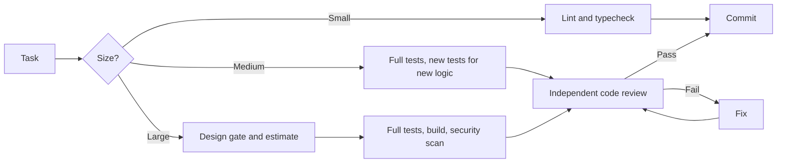

# Steve

**Quality gates and senior-engineer habits for Claude Code.**

AI coding tools make it easy to produce more code than a team can safely review. Steve is a set of Claude Code skills, commands, agents, and a safety hook that give each change a process sized to its risk: plan it, test it, have a separate reviewer check it, then commit it.

There's no service or account, and no packages to install. It's plain Markdown you can read and change, plus two small Node scripts.

## How a change moves through Steve



| Size | Example | Before coding | Testing | After coding |
|---|---|---|---|---|
| **Small** | Up to 3 files, one concern | None | Lint and typecheck | Commit |
| **Medium** | Multi-file change using existing patterns | None | Full suite, plus tests for new logic | Code review, then commit |
| **Large** | New architecture, dependencies, or data model | Design gate and estimate | Full suite, build, security scan | Decision record and code review, then commit |

Through the orchestrator or `/ship`, changes touching auth, file handling, or inter-process messaging also get a security check, whatever their size. The quick `/commit` path skips review and security checks by design.

## What real catches look like

Steve was built while shipping a three-platform desktop app, [Ravenburst](https://ravenburst.com), and its website. Two examples from that work, where the independent review found a problem the tests had missed:

- **Blocklist bypass.** A mailing-list signup blocked disposable email domains, but the reviewer pointed out that `x@mailinator.com.` (with a trailing dot) would slip through. Mail servers treat it as the same domain. The code review failed, and the fix now strips trailing dots in both the address cleanup and the domain check.
- **Files that wouldn't open.** A data migration passed its tests, but the reviewer noticed that a project in a read-only location would now fail to open, because the migration couldn't write to it. The step now skips when the file can't be written.

## Install

You need [Claude Code](https://claude.com/claude-code) and Node 20 or newer. On Windows, you also need Git Bash, because the safety hook and `/commit` checks run in bash.

```bash
git clone <this repo>
cd steve

# See what would change first
node install.mjs --project /path/to/your/repo --dry-run

# For a team: installs into the repo, so everyone gets it when you commit it
node install.mjs --project /path/to/your/repo

# Or just for you: installs into ~/.claude
node install.mjs
```

The installer never overwrites a skill, command, agent, or hook file you've changed unless you pass `--force`, which saves a `.steve-backup` copy first. It adds to your existing `CLAUDE.md` and `settings.json` rather than replacing them, and it's safe to run again. Each run refreshes the text between the `steve:start` and `steve:end` markers in `CLAUDE.md`, so keep your own notes outside them.

Then restart Claude Code and run `/init-steve` in your project.

## What you get

| Command | What it does |
|---|---|
| `/ship` | Code review, tests, then commit |
| `/commit` | Checks for large files, deleted assets, and cache folders, then commits |
| `/review` | Reviews the current diff or, with the `gh` CLI, a PR |
| `/test` | Runs tests at the right depth for the change |
| `/autotest` | Generates and runs an automated test suite |
| `/sdd` | Interviews you, then writes a design document |
| `/status` | Project health summary |
| `/release` | Release checklist |
| `/ci-setup` | Sets up or reviews GitHub Actions |

Most of the work happens without a command: for anything spanning more than one file, the `orchestrator` skill sizes the task and runs the right gates. [docs/REFERENCE.md](docs/REFERENCE.md) lists every skill, command, and agent.

**The safety hook** asks a person to approve risky commands before they run, including force-pushes, `git reset --hard`, `DROP TABLE`, `--no-verify`, `git add .`, and staging likely secrets. Edit the lists at the top of `hooks/block-dangerous.mjs` to fit your team.

## Limits

- **Team use is unproven.** Steve has been used on solo projects so far. There's no before-and-after data from a team yet, so measure your own results.
- **Gates depend on Claude following instructions.** Skills guide Claude; they don't force it. For a hard requirement, also enforce it in CI and branch protection.
- **The safety hook prevents accidents; it isn't a security boundary.** A command can be written in ways its patterns won't recognize.
- **Built for JavaScript and TypeScript.** Language rules also cover C#, C++, Electron, React, SQLite, and Shopify themes. On other stacks, Claude has to work out the equivalent test commands from your project, and `/autotest` only supports Vitest and Playwright.
- **Windows is the only tested platform.** The test suite passes there. The installer and hook use only Node and bash, but macOS and Linux haven't been tested yet.
- **The installer isn't all-or-nothing.** If it's interrupted partway, run it again to finish.

## License

MIT. Steve is an independent project, and isn't affiliated with or endorsed by Anthropic.
